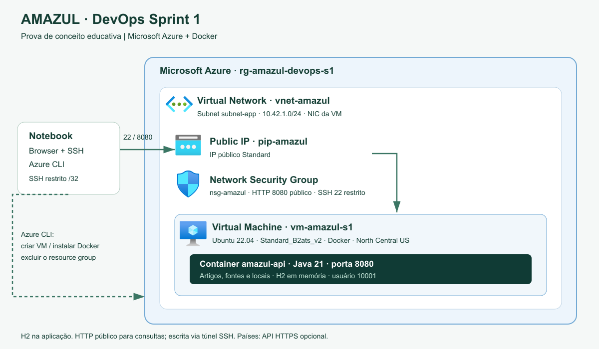

# DevOps Tools & Cloud Computing — Sprint 1

Prova de conceito da API educativa AMAZUL em Docker numa VM Azure. O backend oferece artigos sobre aplicações da tecnologia nuclear, locais e fontes bibliográficas.

| Integrante | RM |
|---|---|
| Sérgio Henrique S. Santos | 567254 |
| Paulo Cavalcante Caroba | 566667 |
| Renan da Silva Paulino | 566610 |

Turma: 2TDSPS. Responsável por DevOps: Sérgio Henrique S. Santos.

## Arquitetura



O Azure CLI provisiona a VM, a rede e as regras de acesso. Docker executa a API com Java 21 em Ubuntu 22.04. As consultas e o Swagger ficam na porta 8080; alterações exigem autenticação. O SSH é restrito ao IP do operador. H2 em memória mantém apenas os dados da demonstração; eles são perdidos ao reiniciar a aplicação. Oracle e a integração Country State City com chave real não foram validados nesse ambiente.

O [SVG da arquitetura](arquitetura/arquitetura.svg) contém os ícones incorporados. Os [ícones Azure](https://learn.microsoft.com/en-us/azure/architecture/icons/) são fornecidos pela Microsoft.

Docker empacota a aplicação e suas dependências. Azure fornece os recursos para executá-la na nuvem. A demonstração inclui provisionamento, build, execução, verificação e exclusão do grupo de recursos.

## Pré-requisitos

- WSL com Bash, Git, Python 3, Azure CLI, OpenSSH, curl e tar.
- Assinatura Azure com permissão para criar e excluir os recursos do laboratório.
- Quota para a VM Standard_B2ats_v2 na região configurada, ou ajuste de região/tamanho em `.local/config.env`.

Os scripts instalam Docker na VM. O código vem do [backend Spring Boot](https://github.com/CHALLENGE-AMAZUL/backend-springboot), no commit `a68135db82ea70503af29a9ff4afd44df8426003`, usado na execução gravada. O script confere o commit e o Dockerfile antes de enviar o código à VM. O backend não é duplicado neste repositório.

## Executar

Na raiz deste repositório, preparar a configuração local:

```bash
mkdir -p .local
cp config.example.env .local/config.env
```

Preencher `SUBSCRIPTION_ID` em `.local/config.env` com o UUID da assinatura. Conferir região, tamanho da VM e nome do grupo de recursos. A autenticação Azure ocorre pelo fluxo de device code quando necessária; o estado e as credenciais ficam em `.local`, ignorada pelo Git.

```bash
bash scripts/azure.sh plan
bash scripts/azure.sh create
bash scripts/azure.sh deploy
bash scripts/azure.sh check
```

`plan` apresenta o ambiente sem criar recursos. `create` provisiona a VM. `deploy` instala Docker, prepara o código e inicia o container. `check` confere health, Swagger, CRUD e proteção de escrita. Os registros ficam em `.local/evidence`.

O deploy informa o endereço do Swagger e o comando de túnel SSH. Para operações autenticadas, abrir o Swagger pelo túnel e usar **Authorize** com os dados de `.local/api.env`. Não publicar esse arquivo nem mostrar sua senha na gravação. Sem `API_COUNTRY_KEY`, os recursos de países retornam 503; os demais recursos da API continuam disponíveis.

Se trocar de rede, repetir `create` para atualizar o IP permitido no SSH.

## Encerrar o laboratório

Após registrar a demonstração, excluir o grupo dedicado:

```bash
CONFIRM_DESTROY=rg-amazul-devops-s1 bash scripts/azure.sh destroy
```

Se alterar `RESOURCE_GROUP`, usar o mesmo nome em `CONFIRM_DESTROY`. O script valida a identificação da execução e registra a confirmação `exists=false` em `.local/evidence/destroy.json`.

## Vídeo da demonstração

[Assistir no YouTube](https://youtu.be/BQV1CYI_7b8) · [Baixar o vídeo](video/AMAZUL_DevOps_Sprint1.mp4)

Demonstração de 3 minutos: provisionamento com Azure CLI, execução da API em Docker, testes pelo Swagger e exclusão dos recursos.

Música: [“Cipher”, Kevin MacLeod](https://incompetech.com/music/royalty-free/index.html?Search=Search&isrc=USUAN1100844) — [CC BY 4.0](https://creativecommons.org/licenses/by/4.0/), trecho editado.

## Referências técnicas

- [Azure CLI — máquinas virtuais](https://learn.microsoft.com/en-us/cli/azure/vm)
- [Instalação Docker no Ubuntu](https://docs.docker.com/engine/install/ubuntu/)
- [Referência Dockerfile](https://docs.docker.com/reference/dockerfile/)
